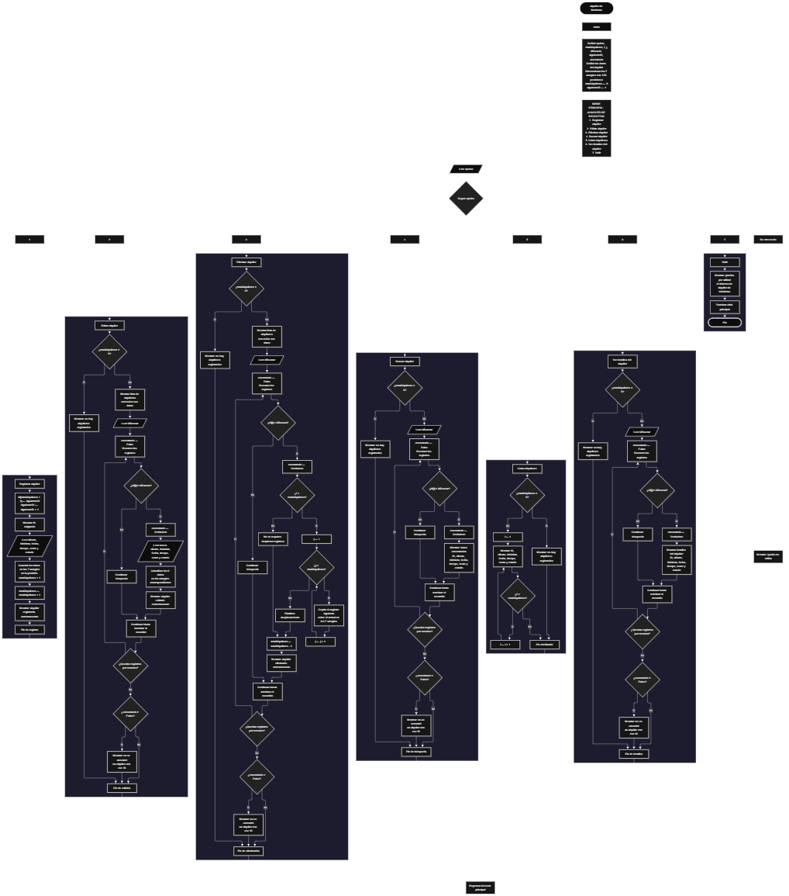

 

Este proyecto, llamado <b>alquiler de bicicletas</b>, fue desarrollado en <b>PSeInt</b> como un ejercicio práctico para fortalecer la lógica de programación mediante la creación de un sistema de gestión de alquileres desde la consola. El programa cuenta con un menú principal de siete opciones que permite <b>registrar, editar, eliminar, buscar, listar y consultar los detalles</b> de los alquileres registrados. Cada alquiler almacena información como el identificador, el nombre del cliente, el tipo de bicicleta, la fecha, el tiempo de alquiler, el costo y el estado. Para organizar estos datos, se utilizan siete arreglos con una capacidad definida de <b>100 posiciones</b>. Durante su desarrollo se aplicaron conceptos fundamentales de programación, como variables, arreglos, estructuras condicionales, ciclos repetitivos y estructuras de selección, además de procedimientos lógicos para localizar, modificar, eliminar y reorganizar registros. Este proyecto permite poner en práctica los conocimientos adquiridos en PSeInt y sirve como base para desarrollar sistemas de gestión más avanzados utilizando otros lenguajes y tecnologías.

<h2 align="center">⚙️ Funcionamiento del menú principal</h2>

### ➕ Registrar alquiler

La opción <b>1) registrar alquiler</b> permite registrar un nuevo alquiler de bicicleta. Al iniciar el proceso, el programa asigna automáticamente un identificador utilizando el arreglo <b>id</b> y la variable <b>siguienteID</b>. Después, incrementa esta última variable para que el siguiente alquiler reciba un identificador consecutivo. A continuación, solicita el <b>nombre del cliente, tipo de bicicleta, fecha del alquiler, tiempo de alquiler, costo y estado</b>. Los datos se almacenan en la posición correspondiente de sus respectivos arreglos. Finalmente, incrementa la variable <b>totalAlquileres</b> en uno y muestra el mensaje <b>"alquiler registrado correctamente."</b>. Actualmente, el código no comprueba si se han alcanzado las 100 posiciones disponibles antes de registrar un alquiler.

### ✏️ Editar alquiler

La opción <b>2) editar alquiler</b> permite modificar la información de un alquiler registrado. Primero, el programa comprueba si la variable <b>totalAlquileres</b> es igual a cero. Si no existen registros, muestra el mensaje <b>"no hay alquileres registrados."</b>. En caso contrario, presenta una lista con los datos de los alquileres almacenados, incluyendo su identificador, cliente, bicicleta, fecha, tiempo, costo y estado. Después, solicita el ID del alquiler que se desea editar y utiliza la variable <b>encontrado</b>, inicialmente establecida en <b>Falso</b>, para comprobar si existe una coincidencia. Cuando encuentra el identificador solicitado, cambia la variable a <b>Verdadero</b> y solicita los nuevos datos del cliente, tipo de bicicleta, fecha, tiempo de alquiler, costo y estado. Los valores se actualizan directamente en los arreglos correspondientes, conservando el ID original. Finalmente, muestra el mensaje <b>"alquiler editado correctamente."</b>. Si no encuentra el identificador, presenta el mensaje <b>"no se encontró un alquiler con ese id."</b>.

### 🗑️ Eliminar alquiler

La opción <b>3) eliminar alquiler</b> permite eliminar un alquiler mediante su identificador. Antes de comenzar, el programa comprueba si existen alquileres registrados. Si no hay registros, muestra el mensaje <b>"no hay alquileres registrados."</b>. Si existen, presenta sus datos y solicita el ID del alquiler que se desea eliminar. A continuación, inicializa la variable lógica <b>encontrado</b> con el valor <b>Falso</b> y recorre los identificadores para localizar el registro. Cuando encuentra una coincidencia, establece la variable en <b>Verdadero</b> y comprueba si el registro seleccionado está antes de la última posición ocupada mediante la condición <b>i &lt; totalAlquileres</b>. Si se cumple, utiliza un ciclo <b>Para</b> controlado por la variable <b>j</b> para desplazar una posición hacia atrás los datos posteriores en los siete arreglos: <b>id, cliente, bicicleta, fecha, tiempo, costo y estado</b>. Después, disminuye la variable <b>totalAlquileres</b> en uno y muestra el mensaje <b>"alquiler eliminado correctamente."</b>. Si no encuentra el ID solicitado, informa que no existe un alquiler con ese identificador. El código no limpia expresamente la última posición después de eliminar, pero deja de considerarla un registro activo al reducir el contador.

### 🔎 Buscar alquiler

La opción <b>4) buscar alquiler</b> permite localizar un alquiler específico mediante su ID. Primero, comprueba si existen registros almacenados. Si no hay alquileres, presenta el mensaje <b>"no hay alquileres registrados."</b>. En caso contrario, solicita el identificador que se desea buscar e inicializa la variable <b>encontrado</b> con el valor <b>Falso</b>. Después, utiliza un ciclo <b>Para</b> para recorrer el arreglo <b>id</b> y comparar cada identificador con el valor introducido mediante la condición <b>id[i] = idBuscar</b>. Cuando encuentra una coincidencia, cambia la variable a <b>Verdadero</b>, muestra el mensaje <b>"datos encontrados"</b> y presenta el ID, el cliente, la bicicleta, la fecha, el tiempo, el costo y el estado del alquiler. Si termina el recorrido sin encontrar el identificador, muestra el mensaje <b>"no se encontró un alquiler con ese id."</b>.

### 📋 Listar alquileres

La opción <b>5) listar alquileres</b> permite visualizar todos los alquileres registrados durante la ejecución del programa. Antes de mostrar los datos, comprueba si la variable <b>totalAlquileres</b> es igual a cero. Si no existen registros, presenta el mensaje <b>"no hay alquileres registrados."</b>. Si hay alquileres disponibles, muestra el encabezado <b>"datos registrados"</b> y utiliza un ciclo <b>Para</b> para recorrer los arreglos desde la primera posición hasta el número total de alquileres activos. En cada iteración presenta el ID, el nombre del cliente, el tipo de bicicleta, la fecha, el tiempo de alquiler, el costo y el estado. Esta opción facilita consultar los registros sin necesidad de buscarlos individualmente.

### 📄 Ver detalles del alquiler

La opción <b>6) ver detalles del alquiler</b> permite consultar de manera individual la información de un alquiler específico. Primero, el programa comprueba si existen alquileres registrados. Si no hay registros, muestra el mensaje <b>"no hay alquileres registrados."</b>. En caso contrario, solicita el ID del alquiler y establece la variable <b>encontrado</b> en <b>Falso</b>. A continuación, recorre los identificadores mediante un ciclo <b>Para</b>. Cuando encuentra el ID solicitado, cambia la variable a <b>Verdadero</b> y presenta el encabezado <b>"detalles del alquiler"</b>. Después, muestra por separado el identificador, el cliente, la bicicleta, la fecha, el tiempo de alquiler, el costo y el estado. Si el recorrido termina sin encontrar coincidencias, presenta el mensaje <b>"no se encontró un alquiler con ese id."</b>. Esta opción permite visualizar la información de forma más clara y organizada.

### 🚪 Salir del menú principal

La opción <b>7) salir</b> permite finalizar el uso del sistema de alquiler de bicicletas. Al seleccionarla, el programa muestra el mensaje <b>"gracias por utilizar el sistema de alquiler de bicicletas."</b>. El menú principal está organizado dentro de una estructura repetitiva <b>Repetir ... Hasta Que</b>, cuya condición de salida es <b>opcion = 7</b>. Por lo tanto, cuando el usuario selecciona la opción 7, el ciclo termina y finaliza la ejecución del algoritmo.

<h2 align="center">🧠 Temas aplicados en el proyecto</h2>

### 📦 Variables

En este proyecto se utilizan variables para almacenar la opción seleccionada en el menú, controlar la cantidad de alquileres registrados, recorrer los arreglos, buscar identificadores, generar nuevos IDs y comprobar si se encontró un alquiler. También se utilizan variables para representar los datos de cada alquiler y organizarlos dentro de los arreglos correspondientes.

🔢 **Opcion:** Almacena la opción seleccionada por el usuario en el menú principal.

📊 **TotalAlquileres:** Mantiene la cantidad actual de alquileres registrados.

🔄 **I:** Controla los recorridos de los arreglos durante las operaciones de edición, eliminación, búsqueda, listado y consulta de detalles.

🔁 **J:** Controla el desplazamiento de los registros posteriores durante la eliminación de un alquiler.

🔎 **IdBuscar:** Almacena el identificador introducido por el usuario para localizar el alquiler deseado.

🆔 **SiguienteID:** Genera los identificadores consecutivos para los nuevos alquileres registrados.

✅ **Encontrado:** Variable lógica que indica si se localizó el alquiler solicitado.

📝 **Cliente:** Almacena el nombre del cliente.

🚲 **Bicicleta:** Guarda el tipo de bicicleta alquilada.

📅 **Fecha:** Almacena la fecha del alquiler.

⏱️ **Tiempo:** Guarda el tiempo del alquiler.

💰 **Costo:** Almacena el costo del alquiler mediante un valor de tipo real.

📌 **Estado:** Guarda el estado del alquiler.

### 🗃️ Arreglos

El programa utiliza siete arreglos dimensionados con <b>100 posiciones</b> para almacenar los datos de los alquileres. Cada arreglo representa un campo de información y todos utilizan el mismo índice para relacionar los datos de un mismo registro. Por ejemplo, el alquiler situado en la posición <b>1</b> tiene su información distribuida entre <b>id[1], cliente[1], bicicleta[1], fecha[1], tiempo[1], costo[1] y estado[1]</b>. Esta organización permite recorrer, consultar, modificar y reorganizar los registros mediante sus posiciones correspondientes.

🆔 **Id[100]:** Almacena los identificadores de los alquileres.

👤 **Cliente[100]:** Almacena los nombres de los clientes.

🚲 **Bicicleta[100]:** Guarda los tipos de bicicleta alquilados.

📅 **Fecha[100]:** Almacena las fechas de los alquileres.

⏱️ **Tiempo[100]:** Guarda el tiempo correspondiente a cada alquiler.

💰 **Costo[100]:** Almacena los costos de los alquileres.

📌 **Estado[100]:** Guarda los estados de los alquileres.

### 🔀 Estructuras condicionales

En el proyecto se utilizan las estructuras <b>Si</b> y <b>SiNo</b> para comprobar si existen alquileres registrados antes de ejecutar las operaciones que los requieren, determinar si un ID coincide con el identificador buscado y controlar el desplazamiento de los registros durante la eliminación. También se utiliza la condición <b>encontrado = Falso</b> para informar cuando no se localiza un alquiler y la condición <b>i &lt; totalAlquileres</b> para determinar si es necesario desplazar los datos de las posiciones posteriores.

### 🔄 Estructuras repetitivas

El programa utiliza los ciclos <b>Repetir ... Hasta Que</b> y <b>Para</b>. El ciclo <b>Repetir ... Hasta Que</b> mantiene activo el menú principal hasta que el usuario selecciona la opción 7. Los ciclos <b>Para</b> permiten recorrer los arreglos para mostrar los alquileres, buscar identificadores y localizar los registros que se desean modificar o consultar. Durante la eliminación, otro ciclo <b>Para</b> desplaza los datos posteriores una posición hacia atrás para mantener organizados los registros activos.

### 🎯 Estructura Según

La estructura <b>Segun opcion Hacer</b> permite ejecutar las instrucciones correspondientes a la opción seleccionada por el usuario. Cada caso representa una función del sistema: <b>registrar alquiler, editar alquiler, eliminar alquiler, buscar alquiler, listar alquileres, ver detalles del alquiler y salir</b>. Además, el bloque <b>De Otro Modo</b> muestra el mensaje <b>"opción no válida."</b> cuando el usuario introduce un valor que no corresponde a las opciones definidas en el menú.

### 🔢 Dimensionamiento de arreglos

La instrucción <b>Dimension</b> establece una capacidad de <b>100 posiciones</b> para cada uno de los siete arreglos utilizados en el programa. La variable <b>totalAlquileres</b> permite controlar cuántos registros se consideran activos, mientras que los ciclos recorren las posiciones comprendidas entre 1 y el total actual. Sin embargo, el código actual no verifica si se ha alcanzado la capacidad de los arreglos antes de registrar un nuevo alquiler, por lo que sería conveniente incorporar una condición que impida superar las posiciones disponibles.

### 🔄 Reorganización de registros

Cuando se elimina un alquiler, el programa reorganiza los datos para conservar la continuidad de las posiciones ocupadas. Después de encontrar el identificador, comprueba si existen registros posteriores. Si los hay, utiliza la variable <b>j</b> para recorrer las posiciones desde el registro eliminado hasta la penúltima posición ocupada. En cada iteración, copia los datos de la posición siguiente a la posición actual en los siete arreglos. Finalmente, disminuye <b>totalAlquileres</b> en uno. Aunque el código no borra los datos de la última posición, estos quedan fuera del rango de registros activos y no se muestran en las operaciones que recorren únicamente el total actualizado.

<h2 align="center">¿Cómo se implementaron las operaciones CRUD en el proyecto?</h2>

Las operaciones <b>CRUD</b> se implementaron mediante las opciones del menú principal, permitiendo administrar los alquileres de bicicletas. La operación <b>crear</b> corresponde a <b>registrar alquiler</b>, donde se asigna un ID y se almacenan los datos del nuevo alquiler. La operación <b>leer</b> se realiza mediante las opciones <b>buscar alquiler, listar alquileres y ver detalles del alquiler</b>, que permiten consultar los registros. La operación <b>actualizar</b> corresponde a <b>editar alquiler</b>, donde se modifican los datos asociados a un ID sin cambiar el identificador. Por último, la operación <b>eliminar</b> se realiza mediante <b>eliminar alquiler</b>, que desplaza los datos posteriores y reduce el total de registros activos. Estas operaciones se desarrollaron utilizando variables, arreglos, condicionales y ciclos para gestionar la información durante la ejecución del programa.

<h2 align="center">Diagrama de flujo del proyecto</h2>

<h2 align="center">🛡️ Validaciones del programa</h2>

### 📭 No existen alquileres registrados

Esta comprobación se utiliza en las opciones <b>editar, eliminar, buscar, listar y ver detalles del alquiler</b>. El programa evalúa si la variable <b>totalAlquileres</b> es igual a cero. Si no existen registros activos, muestra el mensaje <b>"no hay alquileres registrados."</b> y evita continuar con la operación que necesita datos almacenados.

### 🔎 Alquiler no encontrado

Esta comprobación se aplica al editar, eliminar, buscar y consultar los detalles de un alquiler. La variable lógica <b>encontrado</b> se inicializa con el valor <b>Falso</b> y cambia a <b>Verdadero</b> cuando el programa encuentra una coincidencia entre el ID almacenado y el ID introducido por el usuario. Si el recorrido termina y la variable continúa siendo <b>Falso</b>, muestra el mensaje <b>"no se encontró un alquiler con ese id."</b>.

### ⚠️ Capacidad de los arreglos

Los siete arreglos están dimensionados con <b>100 posiciones</b>. Sin embargo, el registro actual no comprueba si <b>totalAlquileres</b> es menor que 100 antes de guardar un nuevo alquiler. Por esta razón, la capacidad máxima está definida en el dimensionamiento, pero todavía no existe una validación que impida intentar registrar más datos de los que los arreglos pueden almacenar. Se recomienda incorporar una condición como <b>totalAlquileres &lt; 100</b> para controlar esta situación.

### 🔢 Identificadores de los alquileres

La variable <b>siguienteID</b> genera identificadores consecutivos. Cada vez que se registra un alquiler, se almacena su ID y se incrementa la variable en uno. Al editar o eliminar un registro, su identificador no se reutiliza durante la ejecución actual. Esto permite distinguir los alquileres mediante un ID, incluso después de eliminar registros anteriores.

### ⚠️ Opción no válida

La estructura <b>Segun</b> incluye el bloque <b>De Otro Modo</b>, que muestra el mensaje <b>"opción no válida."</b> cuando el valor introducido no corresponde a las opciones del menú principal. Las opciones válidas van del 1 al 7, y la condición del ciclo repetitivo utiliza <b>opcion = 7</b> para finalizar el programa.

<h2 align="center">🎯 Objetivo del proyecto</h2>

El objetivo principal de este proyecto es fortalecer la <b>lógica de programación</b> mediante el desarrollo de un sistema de gestión de alquileres de bicicletas en <b>PSeInt</b>. A través de su construcción se busca aplicar conocimientos sobre variables, arreglos, estructuras condicionales, ciclos repetitivos y estructuras de selección, integrándolos para resolver un problema de administración de registros. Además, el proyecto permite comprender cómo registrar, consultar, modificar y eliminar información utilizando identificadores y arreglos relacionados, estableciendo una base para desarrollar sistemas de gestión más completos con otros lenguajes y tecnologías.

